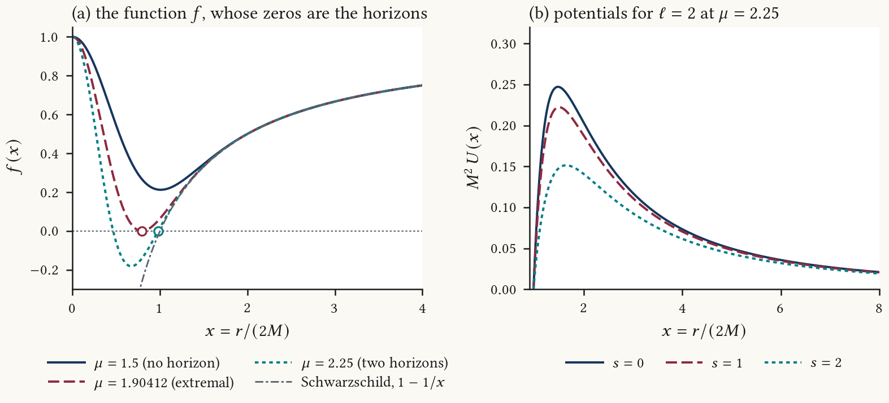

<!-- Author: Dr. Denys Dutykh (Mathematics Department, Khalifa University of Science and Technology, Abu Dhabi, UAE) -->

# noncommschwarzschild: quasinormal modes of noncommutative geometry-inspired Schwarzschild black holes



Panel (a) shows the function f(x) = 1 − erf(μx)/x + (2μ/√π) e^(−μ²x²) of the black hole against the rescaled radius
x = r/(2M), for three values of the rescaled mass μ = M/√θ: for μ = 1.5 it has no zero and there is no horizon; at the
extremal value μ_e = 1.904119 the two horizons merge at x_e = 0.793658 (circle); at μ = 2.25, the mass of the
non-extremal worksheet as distributed, the event horizon lies at x_h = 0.978684 (circle). Beyond x ≈ 1.5 the three
curves join the Schwarzschild function 1 − 1/x. Panel (b) shows, for the same μ = 2.25 and ℓ = 2, the potentials M²U of
the scalar (s = 0), electromagnetic (s = 1) and vector-type gravitational (s = 2) perturbations outside the event
horizon; they peak at 0.2471, 0.2222 and 0.1513, between x = 1.47 and x = 1.64.

noncommschwarzschild holds the Maple and MATLAB material of a study of the quasinormal modes of the Schwarzschild black
hole inspired by noncommutative geometry, whose point mass is smeared into a Gaussian distribution of width √θ, which
replaces the central singularity by a regular de Sitter core. It computes the frequencies at which massless scalar
(s = 0), electromagnetic (s = 1) and vector-type gravitational (s = 2) perturbations ring and decay, for the
non-extremal black hole and for the extremal one. Two Maple worksheets assemble, at 200 digits, the matrices of a
Chebyshev collocation of the compactified radial equation, whose quasinormal boundary conditions are built into a
factorisation of the solution; a MATLAB script solves the resulting quadratic eigenvalue problem with `polyeig` and
draws the spectrum. Two more worksheets verify the analytical steps of the article by Davide Batic and Denys Dutykh in
the European Physical Journal C (2024), cited below.

## The problem

The line element is ds² = −f dt² + dr²/f + r² dΩ², with, in the rescaled radius x = r/(2M) and the rescaled mass
μ = M/√θ (θ being the noncommutativity parameter, an area),

```text
f(x) = 1 − erf(μx)/x + (2μ/√π) e^(−μ²x²).
```

Below the extremal mass μ_e = 1.904119076 the function f has no zero and the geometry has no horizon; at μ_e the two
horizons merge at x_e = 0.7936575898; above it there are two, and the codes work with the outer one, the event horizon
x_h. With the time dependence e^(−iωt) and spherical harmonics of degree ℓ ⩾ s, each perturbation obeys

```text
f d/dr( f dψ/dr ) + [ ω² − U(r) ] ψ = 0,        U(r) = f(r) [ ε f′(r)/r + ℓ(ℓ + 1)/r² ],        ε = 1 − s²,
```

with ψ ingoing at the event horizon and outgoing at infinity; the dimensionless frequency is Ω = Mω, and Im Ω < 0 for
a damped mode. For large μ, f tends to 1 − 1/x and the frequencies to those of the Schwarzschild black hole, which is
the test of the method in the article. The map y = 1 − 2x_h/x (x_e in the extremal case) sends the event horizon to
y = −1 and infinity to y = +1; once the behaviour at both ends has been factored out (with an auxiliary function η(y)
at the double horizon of the extremal case), the regular part is expanded in n Chebyshev polynomials and the equation
is collocated at the n roots y_i = cos((2i − 1)π/(2n)), which gives

```text
( M0 + i Ω M1 + Ω² M2 ) a = 0
```

with three real n × n matrices. The worksheets export `M1` without the factor i, which the MATLAB script applies when
it solves the problem as `polyeig(M0, 1i*M1, M2)`. The derivations, the singularities of the coefficients at y = ±1
and their limits are in the article and in the supplemental worksheets.

## Quick start

The assembly worksheets write their matrices into `data/`, a path relative to the current folder of Maple
(`currentdir()`), which must therefore be the folder of the repository, where `data/` must exist. In a terminal:

```bash
git clone https://github.com/dutykh/noncommschwarzschild.git
cd noncommschwarzschild
mkdir -p data
```

Then open `QNMsNonExtreme.mw` (or `QNMsExtreme.mw`) in Maple, set at its top the spin `s` (0, 1 or 2), the multipole
`L` and, in the non-extremal worksheet, the rescaled mass `mu` (2.25 as distributed); the number of Chebyshev modes is
`n` (150 as distributed) and the working precision `Digits := 200`. The non-extremal worksheet finds the event horizon
by `fsolve` from x = 1, the extremal one solves f = 0 and f′ = 0 for x_e and μ_e (in the square 0 ⩽ x, μ ⩽ 3).
Executing the whole worksheet assembles the matrices, the expensive part of the computation, and writes
`data/M0.mat`, `data/M1.mat` and `data/M2.mat` in the ASCII format of MATLAB. The commented line beside the
collocation points switches from the Chebyshev roots to the Chebyshev extrema. Then, in MATLAB, from the folder of the
repository:

```matlab
findeigs
```

The script reads the three matrices with `readmatrix`, solves `polyeig(M0, 1i*M1, M2)` and draws the eigenvalues in the
plane of Re ω and Im ω. The eigenvalues mix the quasinormal frequencies with artefacts of the truncation: the
frequencies are those that stay in place when the computation is repeated with another n, the matrices of each n being
kept under other names since the file names do not carry it. The article overlaps n = 100, 150 and 200 and solves the
problem in multiprecision, with 200 digits, through the Advanpix Multiprecision Computing Toolbox, whereas
`readmatrix` rounds the 200 digits of the files to double precision; with that toolbox the matrices are read by
`mp.read` and `1i` becomes `mp('1i')`, as in the drivers of the later repositories of this series.

## Contents

| File | Content |
|---|---|
| `QNMsNonExtreme.mw` | Maple worksheet assembling `M0`, `M1` and `M2` for the non-extremal black hole and writing them to `data/` |
| `QNMsExtreme.mw` | the same for the extremal black hole, with its double horizon |
| `NONEXTREME CASE-SUPPLEMENTAL MATERIAL.mw` | Maple worksheet verifying the analytical steps of the article in the non-extremal case: coefficient functions, limits at the ends of the interval, the reduction to the matrix problem |
| `EXTREME CASE-SUPPLEMENTAL MATERIAL.mw` | the same verification in the extremal case |
| `findeigs.m` | the MATLAB script that solves the eigenvalue problem and draws the spectrum |
| `docs/figures/` | the script `plot_readme_figure.py` that draws the figure of this page from f and from the potential, with the style file beside it |

## Requirements

Maple 2022.1 or later, in which the worksheets are saved; they use only `LinearAlgebra` beyond the standard library.
MATLAB R2019a or later for `readmatrix` and `polyeig`, and, to reproduce the multiprecision computations of the
article, the Advanpix Multiprecision Computing Toolbox (a commercial toolbox). The figure of this page needs Python 3
with NumPy, SciPy and Matplotlib, and is redrawn from `docs/figures/` by `python3 plot_readme_figure.py`.

## How to cite

If you use this code, please cite the article:

D. Batic and D. Dutykh, Quasinormal modes in noncommutative Schwarzschild black holes: a spectral analysis, The
European Physical Journal C 84, 622 (2024).

https://doi.org/10.1140/epjc/s10052-024-12981-6

```bibtex
@article{Batic2024a,
  author = {Batic, Davide and Dutykh, Denys},
  title = {Quasinormal Modes in Noncommutative {{Schwarzschild}} Black Holes: A Spectral Analysis},
  journal = {The European Physical Journal C},
  year = 2024,
  month = jun,
  volume = {84},
  number = {6},
  pages = {622},
  doi = {10.1140/epjc/s10052-024-12981-6},
  eprint = {2406.03353},
  archiveprefix = {arXiv}
}
```

The button "Cite this repository" in the right-hand column of this page gives the same reference, read from
`CITATION.cff`. The article is open access, and a free copy is also on arXiv:

https://arxiv.org/abs/2406.03353

A later study treats another noncommutative deformation of the Schwarzschild black hole, built with the Seiberg–Witten
map at second order in the noncommutativity, and computes its quasinormal modes by eight methods; its codes and data are
in the repository

https://github.com/dutykh/noncommutative-schwarzschild-qnms

## Licence

GNU Lesser General Public License, version 2.1 (see `LICENSE`).

## Authors

Davide Batic and Denys Dutykh (Mathematics Department, Khalifa University of Science and Technology, Abu Dhabi). The
article is listed, with the other studies of quasinormal modes of the same group, in the
[Quasi-Normal Modes Hall of Fame](https://qnms.denys-dutykh.com/).

https://www.denys-dutykh.com/
